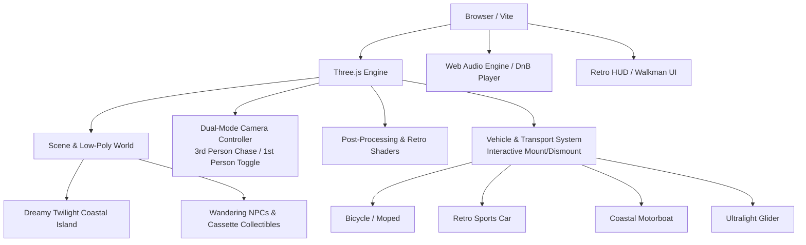

# Atmospheric DnB Retro 3D Adventure — Project Plan

## 1. Vision & Aesthetic Pillars
- **Inspiration**: Late 90s / early 2000s low-poly 3D aesthetics (PS1/PS2, Dreamcast, GTA Vice City beachfront, Ridge Racer Type 4 vibes, Shenmue) paired with atmospheric drum & bass (liquid breakbeats, warm Roland JD-800/JV-1080 style pads, deep sub-bass, coastal chill).
- **Vibe**: Sunny resort coastline fading into hazy golden hour / twilight, towering minimalist beach hotels, swaying palm trees, warm breeze, and an omnipresent rolling rhythm.
- **Platform**: Web-based (**Vite + Three.js**).
  - *Why Web*: Zero install, instant hot-reloading, leverages web development skills, runs smoothly at 60 FPS on low-spec hardware due to low polycounts and efficient WebGL rendering.

---

## 2. Core Architecture & Tech Stack

- **Renderer**: Three.js WebGLRenderer with optional retro pixelation / dither effect and distance haze fog.
- **Physics & Movement**: Custom kinematic character controller with slope handling, smooth acceleration/deceleration, jumping, and collision bounds.
- **Audio System**: Web Audio API player featuring atmospheric DnB tracks with an interactive Walkman/MiniDisc UI overlay.
- **Visual Style**: Unlit/flat-shaded & low-res textured materials, affine-feel textures, vertex fog, retro aspect ratio framing.

---

## 3. Gameplay Mechanics

### Camera & Controls
- **Default Third-Person View**: Over-the-shoulder chase camera tracking the player avatar.
- **First-Person View Toggle**: Hit `V` (or click HUD button) to switch smoothly into first-person exploration.
- **Movement**: `WASD` / Arrow keys to walk/run, `Shift` to sprint, `Space` to jump, Mouse / Touch to look around.

### Vehicle & Transport System (Seamless Enter/Exit with `E`)
- **Bicycle / Moped**: Casual cruising along the boardwalk and narrow pier paths. Agile turning, pedal rhythm animation, and a bell chime.
- **Retro Sports Car (Late-90s Coupe / OutRun style)**: Low-poly wedge car with glowing pop-up headlights and neon taillights. Arcade driving physics (acceleration, smooth turning, light drifting) along the coastal roadway.
- **Motorboat / Speedboat**: Moored at the pier/docks. Floats on dynamic low-poly ocean waves, allowing open-water exploration to offshore rocks, secret sandbars, and the lighthouse.
- **Ultralight Glider / Air Transport**: High vantage cruising. Catch thermal breezes to glide gracefully over the entire island with panoramic views matching the swelling atmospheric DnB pads.

### Core Loop & Activities
1. **Explore the Island by Foot or Vehicle**: Walk the beach, cruise the coast in your sports car, ride a bicycle down the pier, or pilot a boat across the bay.
2. **Mixtape & Cassette Hunting**: Discover lost cassette tapes hidden across the resort (e.g. atop hotel balcony, behind palm grove, offshore lighthouse island) to unlock new atmospheric tracks and secret ambient spots.
3. **NPC Chit-Chat**: Talk to fellow beach dwellers (hotel concierge, beach bum, chill DJ, rollerblader) with retro dialog boxes.
4. **Time of Day / Atmosphere Switcher**: Toggle between *Sunny Afternoon*, *Golden Sunset*, and *Midnight Neon*.

---

## 4. Phase-by-Phase Roadmap

### Phase 1: Engine Setup & Character Controller (Immediate Next Step)
- Scaffold Vite + Three.js project in current directory.
- Build low-poly player character model and smooth third-person/first-person camera controller with collision detection.
- Add retro UI overlay (controls indicator, camera toggle).

### Phase 2: Starting Zone — Dreamy Twilight Coastal Island
- **Environment**: Pier & wooden docks, seaside gazebo/chill pavilion, distant glowing lighthouse, illuminated retro Japanese-style vending machines, winding coastal paths, palm trees, low-poly rocks, and animated ocean waves with reflective twilight sheen.
- **Atmosphere**: Dusk/sunset gradient sky, soft purple/pink/orange horizon haze, warm streetlamp glows, and retro distance fog.

### Phase 3: Atmospheric DnB Audio Experience
- Implement the "Retro Walkman" audio player HUD (play/pause, track titles, animated spectrum/cassette reels).
- Integrate curated atmospheric drum & bass audio loops/tracks and coastal ambient sounds (waves, breeze).

### Phase 4: Vehicles & Cruising Mechanics
- **Interaction System**: Walk up to any vehicle and press `E` to mount/drive, press `E` again to dismount.
- **Bicycle / Moped**: Smooth two-wheeler steering, pedal animation, boardwalk bell chime.
- **Retro Sports Car**: Arcade driving model with smooth acceleration, coasting, drift slide, glowing pop-up headlights, and neon trail effects.
- **Coastal Motorboat**: Watercraft buoyant physics reacting to ocean vertex waves, steering across the bay.
- **Ultralight Glider**: Runway launch, gentle pitch/yaw gliding over the island with panoramic aerial camera view.

### Phase 5: Adventure Elements & NPCs
- Add collectible cassette tapes with visual markers and discovery sound cues.
- Add low-poly wandering NPCs with retro speech bubble / dialog interactions.
- Add time-of-day switcher (Sunset Twilight / Deep Midnight / Golden Afternoon).

### Phase 6: Multi-Zone Expansions (Later Phases)
- **Zone 2: Y2K Retro-Futuristic City Rooftops**: Elevated bridges, neon signs, skyscrapers, night rain haze.
- **Zone 3: Seaside Japanese Suburb / Mountain Coast**: Train station stop, telephone poles, seaside convenience store.
- **Zone 4: Surreal Dreamcast Liminal World**: Floating geometric monuments, pastel skies, dream-like vibe.
- **Transit/Portals**: Fast travel via ferry, train terminal, or surreal warp points between zones.

### Phase 7: Polish & Retro Shaders
- Optional PS1/PS2 post-processing (pixelation pass, dither/color depth quantization, CRT scanlines).
- Performance optimizations ensuring smooth 60fps on low-spec hardware.
